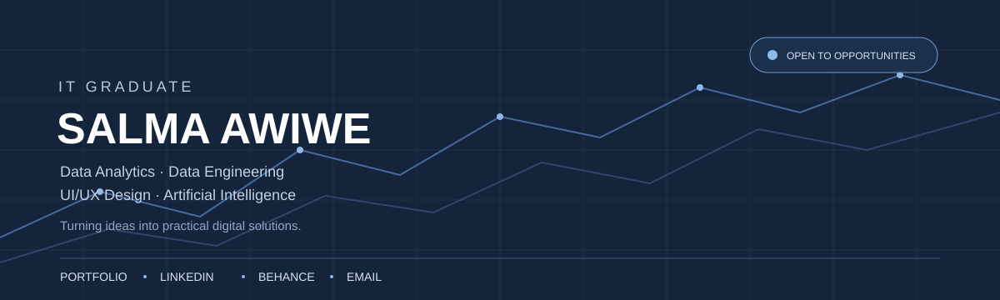

---

## About Me

I'm an IT graduate interested in **Data Analytics, Data Engineering, UI/UX Design, and Artificial Intelligence**.

I enjoy working with data, creating interactive dashboards, designing user interfaces, and exploring AI-powered solutions through practical projects.

---

## Technical Skills

<table>
<tr>
<td width="50%" valign="top">

### Data Analytics

- Data Analytics
- Data Visualization
- Data Quality

</td>
<td width="50%" valign="top">

### Data Engineering

- Data Engineering
- Data Integration

</td>
</tr>
<tr>
<td width="50%" valign="top">

### UI/UX Design

- UI/UX Design
- Wireframing
- User Flows

</td>
<td width="50%" valign="top">

### Artificial Intelligence

- Artificial Intelligence (AI)
- Prompt Engineering

</td>
</tr>
</table>

---

### Let's Connect

<a href="https://salma2220.github.io/salma-portfolio-new/">Portfolio</a> &nbsp; · &nbsp;
<a href="https://www.linkedin.com/in/salma-awiwe">LinkedIn</a> &nbsp; · &nbsp;
<a href="https://www.behance.net/salmaowiwy">Behance</a> &nbsp; · &nbsp;
<a href="https://mail.google.com/mail/?view=cm&fs=1&to=salma.awiwe@gmail.com" target="_blank">Email</a>

